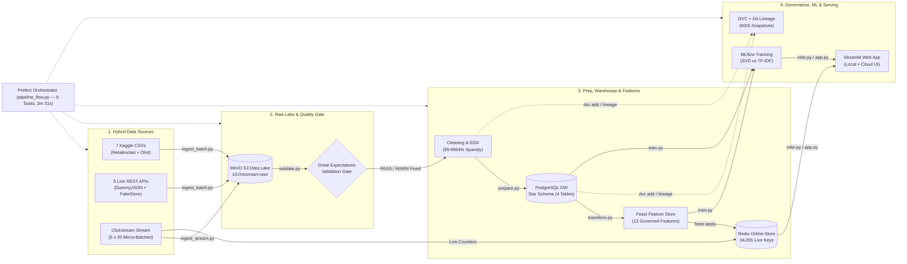
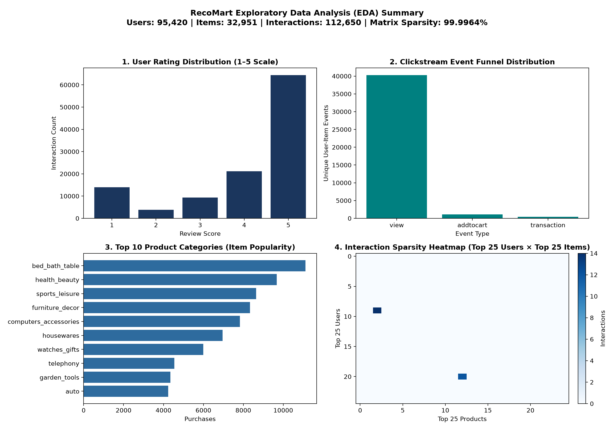

<div align="center">

# 🛒 RecoMart — End-to-End ML Data Pipeline & Recommendation Engine

**Automated, Modular Data Management & MLOps Pipeline for E-Commerce Personalization**  
*BITS Pilani WILP • M.Tech Data Science & Engineering • Data Management for Machine Learning (`S1-26_DSEZG529`)*

[](https://recomart-dmml-pipeline.streamlit.app)
[](https://github.com/saikiran123456/recomart-dmml-pipeline)
[](https://www.python.org/)
[](https://www.docker.com/)


[Live App](#-live-streamlit-application) •
[Architecture](#%EF%B8%8F-end-to-end-system-architecture) •
[Key Results](#-key-results--empirical-findings) •
[Datasets & Schema](#-datasets--warehouse-schema) •
[Quick Start](#-quick-start-local-execution) •
[Repo Structure](#-repository-structure) •
[Team](#-team-contributions)

</div>

---

## 📌 Project Overview

**RecoMart** is a production-grade, end-to-end data management and machine learning pipeline built to solve real-world e-commerce recommendation challenges—including multi-source ingestion, automated schema/quality validation, extreme interaction sparsity (**99.9964%**), training-serving feature consistency, dataset lineage, experiment tracking, workflow orchestration, and live inference serving.

Rather than stopping at an isolated Jupyter notebook, the system integrates **9 open-source data & MLOps technologies** running locally via Docker Desktop and deploys an interactive 4-tab web application to **Streamlit Community Cloud**.

> 🚀 **Try the Live Application:** [https://recomart-dmml-pipeline.streamlit.app](https://recomart-dmml-pipeline.streamlit.app) *(Runs in Cloud Demo Snapshot mode with zero setup, or automatically connects live to Docker/Feast/Redis when run locally.)*

---

## 🏗️ End-to-End System Architecture

*(Interactive diagram — use GitHub's built-in pan/zoom controls in the top-right corner of the diagram to inspect individual nodes.)*



---

## 📊 Key Results & Empirical Findings

| Metric / Milestone | Verified Outcome | Engineering Significance |
| :--- | :--- | :--- |
| **PostgreSQL Warehouse Scale** | **95,420** Users • **32,951** Items • **112,650** Interactions • **4,058** Co-Purchase Pairs | Full relational star schema (`dim_users`, `dim_items`, `fact_interactions`, `item_co_occurrence`) |
| **Matrix Sparsity Diagnosis** | **99.9964%** Sparse (`112,650 / (95,420 × 32,951)`) | Most shoppers purchase only 1–2 items, limiting pure collaborative overlap |
| **Winning Model (`MLflow`)** | **Content-Based TF-IDF + Metadata** (`0.4510` NDCG@10, `0.6100` Recall@10) | Outperformed Truncated SVD (`0.2946` NDCG@10) by **+53.1% relative NDCG** |
| **Online Feature Store (`Feast + Redis`)** | **34,055** Live Keys Materialized (`1,010` users + `1,010` items) | Sub-millisecond online feature retrieval with zero training-serving skew |
| **Dataset Lineage (`DVC`)** | **114.68 MB** Raw → **17.61 MB** Processed → **4.79 MB** Features | Every tier sealed with cryptographic MD5 hashes in Git |
| **End-to-End Orchestration (`Prefect`)** | **9 / 9 Tasks Passed** in **3m 31s** (Run `sandy-toucanet`) | Automated retries, dependency enforcement, and stage-by-stage audit logs |

### Model Evaluation Comparison (500 Held-Out Users, 100-Item Candidate Ranking)

| Model Architecture | MLflow Run ID | Precision@10 | Recall@10 | NDCG@10 | Relative Lift (NDCG@10) |
| :--- | :--- | :---: | :---: | :---: | :---: |
| **Content-Based Filtering (TF-IDF + Metadata + API Scores)** | `a416d532...` | **0.0610** | **0.6100** | **0.4510** | **+53.1% (Winner)** |
| **Collaborative Filtering (Truncated SVD, `k=25`)** | `c494a210...` | `0.0466` | `0.4660` | `0.2946` | Baseline |

<details>
<summary><b>📈 Click to View Generated 4-Panel EDA & Sparsity Proof (<code>reports/05_eda_summary_plots.png</code>)</b></summary>
<br>



* **Panel 1 (Rating Distribution):** Heavily skewed toward 5-star reviews (`>60,000`), requiring price and popularity normalization.
* **Panel 2 (Clickstream Funnel):** Over `40,000` product views funneling into `addtocart` and `transaction` events.
* **Panel 3 (Top 10 Categories):** Led by `bed_bath_table`, `health_beauty`, and `sports_leisure`.
* **Panel 4 (Sparsity Heatmap):** Visual proof of **99.9964% matrix sparsity** explaining why Content-Based + External API signals decisively outperform SVD.

</details>

---

## 🖥️ Live Streamlit Application

The interactive frontend (`app.py`) bridges the backend engineering stack with an intuitive stakeholder dashboard across **four tabs**:

1. **🎯 Live Recommender:**
   * **Returning Shopper Personalization:** Pulls live user features from **Feast + Redis** locally (or Parquet snapshot in cloud), displays past orders, excludes already-purchased items, and ranks Top-K products via cosine similarity.
   * **Category Filter & Top-K Slider:** Dynamically filters recommendations by English product category and adjusts cutoff `K` (`5–20`).
   * **Cold-Start Mode Toggle:** Simulates a zero-history visitor using weighted external popularity (`0.6 × external_popularity + 0.4 × avg_rating`).
   * **Frequently Bought Together:** Surfaces co-purchased product bundles from `item_co_occurrence`.
2. **⚙️ Pipeline & Prefect DAG:** Visualizes task-level durations across all 9 orchestrated stages (`sandy-toucanet`, `3m 31s`) and reconciles PostgreSQL row counts.
3. **📊 Data Quality & EDA:** Interactive Great Expectations validation scorecard, category demand charts, rating distribution, and expandable full EDA report.
4. **🧪 MLflow, Feast & DVC Lineage:** Side-by-side model metric comparison, DVC MD5 version hashes, and Feast feature registry definitions.

---

## 🗄️ Datasets & Warehouse Schema

<details>
<summary><b>📂 Click to Expand Full Raw Dataset Catalog (11 Sources) & Automated Quality Gate Results</b></summary>
<br>

| Dataset / Endpoint | Source Type | Partition / Location | Rows | Missing (Key Cols) | Duplicates | Validation Gate Status |
| :--- | :--- | :--- | :---: | :---: | :---: | :--- |
| `events.csv` (Retailrocket) | Batch CSV | `s3://recomart-raw/csv/clickstream/` | 50,000 | 0 | 9,457 | `WARN` → Deduplicated to `41,783` |
| `olist_orders_dataset.csv` | Batch CSV | `s3://recomart-raw/csv/transactions/` | 99,441 | 0 | 0 | `PASS` |
| `olist_order_items_dataset.csv` | Batch CSV | `s3://recomart-raw/csv/transactions/` | 112,650 | 0 | 0 | `PASS` (`price > 0` verified) |
| `olist_order_reviews_dataset.csv` | Batch CSV | `s3://recomart-raw/csv/transactions/` | 99,224 | 0 | 814 | `WARN` → Deduplicated (`1–5` range PASS) |
| `olist_customers_dataset.csv` | Batch CSV | `s3://recomart-raw/csv/transactions/` | 99,441 | 0 | 0 | `PASS` |
| `olist_products_dataset.csv` | Batch CSV | `s3://recomart-raw/csv/catalog/` | 32,951 | 610 | 0 | `WARN` → Imputed as `"unknown"` |
| `product_category_name_translation.csv` | Batch CSV | `s3://recomart-raw/csv/catalog/` | 71 | 0 | 0 | `PASS` |
| `products.json` (DummyJSON API) | REST API | `s3://recomart-raw/api/catalog/` | 100 | 0 | 0 | `PASS` (`price > 0` verified) |
| `fakestore_popularity.json` (FakeStore API) | REST API | `s3://recomart-raw/api/external_scores/` | 20 | 0 | 0 | `PASS` (External ratings & vote counts) |
| `dummyjson_comments.json` (DummyJSON API) | REST API | `s3://recomart-raw/api/external_scores/` | 100 | 0 | 0 | `PASS` (TextBlob NLP sentiment) |
| `batch_HHMMSS.json` (Clickstream Stream) | Micro-Batch | `s3://recomart-raw/stream/clickstream/` | 5 × 20 | 0 | 0 | `PASS` (Mirrored to MinIO + Redis) |

</details>

<details>
<summary><b>🏛️ Click to Expand PostgreSQL Star Schema, Feast Views & DVC Lineage</b></summary>
<br>

### PostgreSQL Data Warehouse (`recomart_dw`) & Feast Feature Views

* **`dim_users` (`user_features.parquet` — 95,420 rows) → Feast View `user_stats_features`:**
  `customer_unique_id` (PK), `state_encoded`, `user_order_count`, `user_total_spend`, `user_avg_rating`, `user_click_events`
* **`dim_items` (`item_features.parquet` — 32,951 rows) → Feast View `item_stats_features`:**
  `product_id` (PK), `category_english`, `category_encoded`, `avg_price`, `price_normalized`, `item_purchase_count`, `item_avg_rating`, `external_popularity_score`, `external_sentiment_score`
* **`fact_interactions` (`clean_interactions.parquet` — 112,650 rows):**
  `order_id`, `customer_unique_id` (FK), `product_id` (FK), `price`, `review_score`, `order_purchase_timestamp`, `timestamp_normalized`, `category_english`
* **`item_co_occurrence` (`item_co_occurrence.parquet` — 4,058 pairs):**
  `product_id_a`, `product_id_b`, `co_occurrence_count`, `similarity_score`

### DVC Dataset Versioning & MD5 Lineage (`data/lineage_metadata.json`)

| Pipeline Stage | DVC Pointer | Files | Size (MB) | Cryptographic MD5 Hash |
| :--- | :--- | :---: | :---: | :--- |
| **1. Raw Data Lake** | `data/raw.dvc` | 45 | `114.68` | `e64eefe16a47cf558ab35cd029e77b61.dir` |
| **2. Cleaned & Prepared Datasets** | `data/processed.dvc` | 3 | `17.61` | `eb18d3cfdf54b69d88d48ca897044e53.dir` |
| **3. Engineered Feature Tables** | `data/features.dvc` | 3 | `4.79` | `0e637fb1165a38f63700cf0e7a3c3784.dir` |

</details>

---

## ⚡ Quick Start (Local Execution)

### Prerequisites
* **Windows 10/11** with **Docker Desktop** running (green engine status)
* **Python 3.11+** with `.venv` created and local dependencies installed (`pip install -r requirements-local.txt`)

### 1. Start Infrastructure, Reload Redis & Launch Servers (3 Terminals)

```powershell
# Terminal 1 — Start MinIO, PostgreSQL, Redis, repopulate Redis online store & launch Prefect UI
docker compose up -d
.\.venv\Scripts\Activate.ps1
python src/feature_store_demo.py
prefect server start
```

```powershell
# Terminal 2 — Launch MLflow Tracking Server
.\.venv\Scripts\Activate.ps1
mlflow ui --backend-store-uri sqlite:///mlflow.db
```

```powershell
# Terminal 3 — Launch Live Streamlit Frontend Application
.\.venv\Scripts\Activate.ps1
streamlit run app.py
```

### 2. Service Endpoints & Credentials

| Service | Local URL | Credentials / Notes |
| :--- | :--- | :--- |
| **Streamlit Web App (Local)** | `http://localhost:8501` | Connects live to Feast + Redis (`localhost:6379`) |
| **Streamlit Web App (Cloud)** | `https://recomart-dmml-pipeline.streamlit.app` | Public deployment running `app_data/` snapshot |
| **Prefect Orchestration UI** | `http://127.0.0.1:4200` | Flow: `RecoMart_End_To_End_Data_Pipeline` |
| **MLflow Experiment UI** | `http://127.0.0.1:5000` | Experiment: `RecoMart_Recommendation_Models` |
| **MinIO S3 Object Console** | `http://localhost:9001` | User: `admin` • Password: `password123` • Bucket: `recomart-raw` |
| **PostgreSQL Warehouse** | `localhost:5432` | DB: `recomart_dw` • User: `recomart` • Pass: `recomart123` |

<details>
<summary><b>🛠️ Click to Expand Full End-to-End Pipeline Execution & Verification Commands</b></summary>
<br>

```powershell
# Activate environment & point to local Prefect API
.\.venv\Scripts\Activate.ps1
$env:PREFECT_API_URL = "http://127.0.0.1:4200/api"

# Option A: Execute the entire 9-stage orchestrated Prefect DAG (~3m 31s)
python src/pipeline_flow.py

# Option B: Verify live Redis keys, PostgreSQL star-schema counts & CLI Top-10 inference
docker exec recomart-redis redis-cli DBSIZE
docker exec recomart-postgres psql -U recomart -d recomart_dw -c "SELECT 'dim_users' AS tbl, COUNT(*) FROM dim_users UNION ALL SELECT 'dim_items', COUNT(*) FROM dim_items UNION ALL SELECT 'fact_interactions', COUNT(*) FROM fact_interactions UNION ALL SELECT 'item_co_occurrence', COUNT(*) FROM item_co_occurrence;"
python src/infer.py

# Clean Shutdown (after pressing Ctrl+C in Terminals 1–3)
docker compose stop
```

</details>

---

## 📁 Repository Structure

<details>
<summary><b>🌲 Click to Expand Complete Directory & File Tree</b></summary>
<br>

```text
recomart-dmml-pipeline/
├── app.py                              # 4-tab Streamlit frontend (Local Docker + Cloud Snapshot modes)
├── docker-compose.yml                  # MinIO (:9000/:9001), PostgreSQL (:5432), Redis (:6379)
├── requirements.txt                    # Cross-platform dependencies for Streamlit Community Cloud
├── requirements-local.txt              # Full local Windows environment freeze
├── README.md                           # Project documentation & interactive architecture guide
│
├── app_data/                           # Lightweight Parquet snapshot (200 users, 3,000+ items) for cloud app
│   ├── interactions_sample.parquet
│   ├── user_features_sample.parquet
│   ├── item_features_sample.parquet
│   └── item_co_occurrence_sample.parquet
│
├── data/                               # DVC-tracked dataset pointers & lineage metadata
│   ├── raw.dvc                         # Pointer to 114.68 MB raw data lake snapshot
│   ├── processed.dvc                   # Pointer to 17.61 MB cleaned Parquet files
│   ├── features.dvc                    # Pointer to 4.79 MB engineered feature tables
│   └── lineage_metadata.json           # Stage provenance, record counts & MD5 hashes
│
├── feature_repo/                       # Feast Feature Store configuration & definitions
│   ├── feature_store.yaml              # SQLite registry + Redis online store config
│   └── features.py                     # Entities (customer, product) & FeatureViews (12 features)
│
├── models/                             # Serialized recommendation artifacts tracked in MLflow
│   ├── content_based_model.pkl         # Winning TF-IDF + metadata cosine recommender
│   └── svd_model.pkl                   # Truncated SVD (k=25) collaborative baseline
│
├── sql/
│   └── schema.sql                      # PostgreSQL star-schema DDL (4 tables + indexes)
│
├── src/                                # 12 modular pipeline, governance & utility scripts
│   ├── ingest_batch.py                 # Task 1a: Batch CSVs + 3 REST APIs -> MinIO
│   ├── ingest_stream.py                # Task 1b: Near-real-time clickstream micro-batches -> MinIO + Redis
│   ├── validate.py                     # Task 2: Great Expectations & schema quality gate
│   ├── prepare.py                      # Task 3: Cleaning, encoding, scaling & EDA plot generation
│   ├── transform.py                    # Task 4: Feature engineering, NLP sentiment & PostgreSQL load
│   ├── feature_store_demo.py           # Task 5: Feast registry apply, Redis materialization & retrieval
│   ├── lineage_tracker.py              # Task 6: DVC metadata & lineage documentation
│   ├── train.py                        # Task 7: SVD vs Content-Based training & MLflow logging
│   ├── infer.py                        # Task 8: Live Redis lookup & Top-10 recommendation inference
│   ├── pipeline_flow.py                # Task 9: Prefect 9-task DAG orchestration & monitoring
│   ├── generate_docs.py                # Automated PDF/Markdown report generator
│   └── export_app_sample.py            # Cloud snapshot exporter for Streamlit deployment
│
├── reports/                            # Generated deliverable PDFs, Markdown docs & EDA plots
│   ├── 01_problem_formulation.pdf
│   ├── 03_storage_architecture.md
│   ├── 04_data_quality_report.pdf
│   ├── 05_eda_summary_plots.pdf
│   ├── 05_eda_summary_plots.png
│   ├── 06_feature_engineering_logic.md
│   ├── 07_feature_metadata_docs.md
│   ├── 08_data_versioning_lineage.md
│   └── 09_model_performance_report.pdf
│
└── logs/                               # Stage-by-stage execution & audit logs (Tasks 1–10)
```

</details>

---

## 👥 Team Contributions

| Team Member | BITS ID | Primary Ownership & Contributions |
| :--- | :---: | :--- |
| **Saikiran Dasari** | `2025ns04074` | Docker infrastructure (`MinIO`, `PostgreSQL`, `Redis`), batch/stream ingestion, data lake partitioning, Great Expectations validation, cleaning/EDA, feature engineering, PostgreSQL star schema, and Redis integration |
| **Ashish Jaiswal** | `2025ns04127` | Prefect DAG pipeline orchestration, MLflow experiment tracking, offline model evaluation (`Precision@10`, `Recall@10`, `NDCG@10`), and project integration |
| **Vijay Kumar Tyagi** | `2025ns04120` | Workflow automation, task dependency enforcement, retry/failure handling, pipeline execution validation, and centralized audit logging |
| **Shubhangi Rao Dhore** | `2025ns04029` | Streamlit interactive dashboard, live personalized recommendation UI, Cold-Start fallback mode, co-occurrence bundle visualization, and application demo |
| **Nayana J Bhat** | `2025ns04016` | Business problem formulation, hybrid data-source identification, recommendation objectives, evaluation metric design, and overall solution framing |

---

<div align="center">

**Built with ❤️ for Data Management for Machine Learning (`S1-26_DSEZG529`) — BITS Pilani WILP**

</div>
